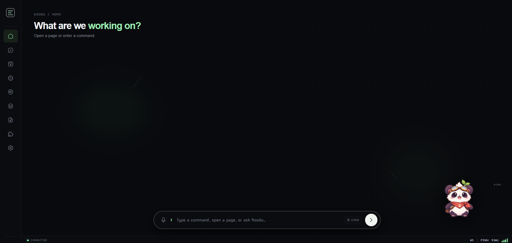

# Koodu

> An open-source AI agent environment for the web — a persistent companion, a multi-agent runtime, hybrid local/cloud intelligence, and a stateful multi-tab workspace, all coordinated through a central middleware layer.


> ✌️ **Active development.** Koodu is a working vertical prototype, not a finished product. Expect rough edges, half-wired features, and breaking changes between commits. The architecture is settling, the UI is being refined, and several engines (voice, personality, memory curation, full action execution) are still in progress. If you spot something broken or want to help shape where it goes, issues and pull requests are very welcome — happy to have you along.

## What it is

Koodu is not a chatbot with an animated avatar. It is an **agent operating environment**: a persistent companion (floating or embedded) sits above a workspace of internal tabs, and every action the AI proposes passes through a central middleware that validates, authorizes, and executes it. Models and sub-agents never touch UI state directly.

The companion reacts to what the system is doing, but it does not own the system's state.

## Highlights

- **Persistent companion** — Kumo (panda) and Kitsu (kitsune), selectable in Settings, with manifest-driven sprite animation. Floating, embedded, or hidden display modes.
- **Stateful workspace** — internal routes (`/workspace/usage`, `/workspace/models`, `/workspace/agents`, `/workspace/chats`, `/workspace/memory`, `/workspace/logs`, `/workspace/skills`, `/workspace/settings`) rendered in persistent tabs.
- **Central middleware** — single authority for application state, event bus, action registry, permission checks, and persistence. All model output is validated before execution.
- **Hybrid intelligence** — local inference for simple, latency-sensitive commands; cloud for complex reasoning. Confidence-based fallback.
- **Agent orchestration** — a main companion agent coordinates Research, Coding, Organizer, and Memory sub-agents with task lifecycle tracking.
- **Server-side secrets** — inference runs on the Fastify server. API keys never reach the browser.
- **Durable storage** — SQLite on the server (model profiles, skills, memory, chats, settings, usage). Browser keeps only a validated write-through cache.

## Architecture

Five independent engines coordinated by middleware:

| Engine | Responsibility |
|---|---|
| `PetEngine` | Avatar rendering, animation, activity/emotion/display state |
| `WorkspaceEngine` | Tab and iframe lifecycles, layout, persistence |
| `MiddlewareEngine` | Central state, event bus, action registry, validation, permissions |
| `IntelligenceEngine` | Local/cloud routing, intent proposals, fallback |
| `AgentEngine` | Main agent + sub-agent orchestration, task lifecycle |

Engines communicate through defined interfaces and events. They are independently replaceable.

## Quick start

**Prerequisites:** Node.js 22.18+, pnpm 12.x.

```sh
pnpm install
cp .env.example .env
pnpm dev               # web on :5173, server on :8787
```

Open <http://localhost:5173>. The Vite dev server proxies `/api` and `/ws` to the backend.

Run them separately:

```sh
pnpm dev:server       # http://127.0.0.1:8787
pnpm dev:web          # http://localhost:5173
```

## Verify

```sh
curl http://127.0.0.1:8787/api/health
pnpm typecheck
pnpm test
pnpm --filter @koodu/web build
```

## Repository map

```text
apps/
  web/            React shell, workspace, engines, pages
  server/         Fastify API, inference adapters, SQLite storage
protocol/         @koodu/protocol — shared TypeScript/Zod contracts
assets/
  companion/      Character spritesheets and animation manifests
  demo/           Screenshots
docs/adr/         Architecture decisions
```

## UI Example




## Development notes

- All inference and secrets stay server-side. The browser never sees API keys.
- Model output is never executed directly. It is validated against the action registry and permission system before anything runs.
- Browser storage is a validated write-through cache only; the server SQLite row is authoritative. Old browser keys are never migrated.
- Settings, model profiles, skills, memory, chats, and usage are persisted in SQLite and synced over the central WebSocket (`/ws`).

## License

MIT